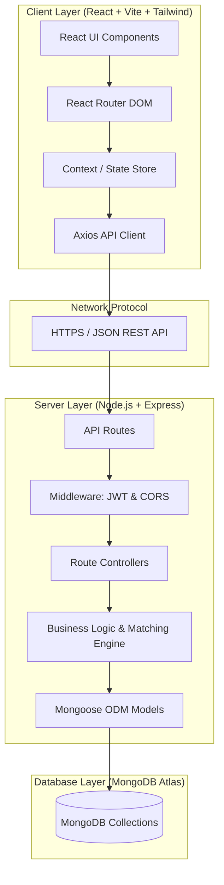
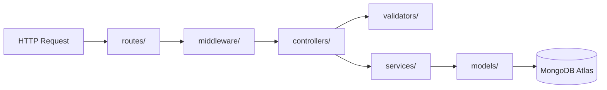
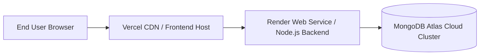

# NestMatch — System Architecture Document

## 1. High-Level Architecture Overview

NestMatch is built on the **MERN (MongoDB, Express.js, React.js, Node.js)** architecture. The system strictly decouples the client-side single-page application (SPA) from the server-side RESTful API to ensure high modularity, independent scalability, and testability.



---

## 2. Frontend Architecture (`client/src/`)

The frontend application follows an Atomic & Feature-Sliced component hierarchy:

```text
client/src/
├── assets/         # Static media, icons, and illustrations
├── components/     # Reusable atomic UI components (Buttons, Cards, Inputs, Modals)
├── layouts/        # Shell layouts (Navbar + Content + Footer wrapper)
├── pages/          # Full route view screens (Home, Profile, Questionnaire, Matches)
├── routes/         # Routing tables, route guards, and Route definitions
├── services/       # Network API integration (Axios client with interceptors)
├── context/        # React context providers (AuthContext, MatchContext)
├── hooks/          # Custom hooks (useAuth, useMatches, useDebounce)
├── utils/          # Formatting functions, math helpers, and client validators
├── constants/      # Static configuration values, roles, route URLs
├── App.jsx         # Root router provider
├── main.jsx        # React DOM render entrypoint
└── index.css       # Tailwind CSS directives and global typography
```

### 2.1 State & Network Flow
1. **Presentation Layer**: Components trigger actions and render UI using props and hooks.
2. **Context Layer**: `AuthContext` manages user authentication token and profile state globally.
3. **Service Layer**: Centralized `api.js` Axios instance injects Authorization headers:
   ```javascript
   Authorization: Bearer <JWT_TOKEN>
   ```

---

## 3. Backend Architecture (`server/`)

The backend adopts a **Layered Architecture (Controller-Service-Repository Pattern)**:



### 3.1 Responsibilities by Layer
- **`routes/`**: Defines HTTP paths, HTTP methods, and attaches appropriate middleware and controller handlers. No business logic resides in route files.
- **`middleware/`**: 
  - `authMiddleware`: Extracts and verifies JWT from Bearer token headers.
  - `roleMiddleware`: Enforces Role-Based Access Control (RBAC).
  - `errorMiddleware`: Captures exceptions, standardizes HTTP error payloads, and avoids sensitive stack trace leaks.
- **`controllers/`**: Extracts parameters from `req.body`, `req.params`, and `req.query`, invokes services, and sends JSON response status codes.
- **`services/`**: Houses core business logic (e.g., preference weighting algorithms, compatibility matrix calculations, request transitions).
- **`models/`**: Defines Mongoose Schemas, validation constraints, default values, and virtual properties.
- **`config/`**: Manages environment variables and database connections (`db.js`).

---

## 4. Role-Based Access Control (RBAC)

The system defines two primary actors:

| Role | Permitted Access | Restricted Access |
|---|---|---|
| **`student`** | - View/Edit own Profile<br>- Complete/Update Questionnaire<br>- View Matches & Match Breakdown<br>- Send/Accept/Reject Requests<br>- Student Settings | - Admin Dashboard<br>- User Moderation<br>- Access to other students' passwords |
| **`admin`** | - System Analytics & Metrics<br>- User Listing & Search<br>- Account Status Moderation (Ban/Activate)<br>- Review Submitted Reports | - Modifying private questionnaires of students<br>- Impersonating student requests |

---

## 5. Deployment Architecture



- **Frontend**: Hosted on **Vercel** with automatic HTTPS, continuous deployment from the main branch, and single-page application fallback routing (`vercel.json`).
- **Backend**: Hosted on **Render** as a managed Node.js web service running `npm start`.
- **Database**: Hosted on **MongoDB Atlas** with automated automated IP access rules and encrypted connections over TLS (`mongodb+srv://`).
