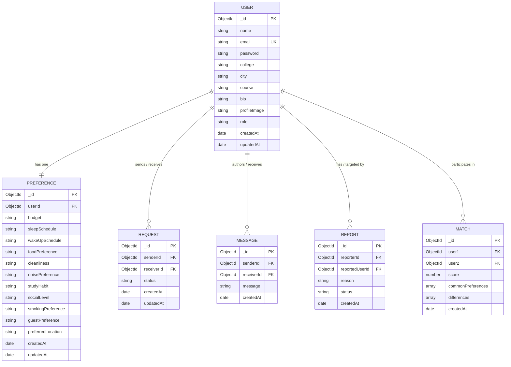

# NestMatch — Database Design & Schema Plan

## 1. Overview
NestMatch uses **MongoDB** as its primary document-oriented database, managed via the **Mongoose ODM**. The schema architecture is designed for optimal student profile retrieval, fast preference comparisons, and transparent relationship tracking.

---

## 2. Entity-Relationship Diagram (ERD)

---

## 3. Detailed Collection Specifications

### 3.1 `User` Collection
Stores student identity, university credentials, profile details, and role authorization.

| Field | Type | Required | Unique | Default | Description |
|---|---|---|---|---|---|
| `_id` | ObjectId | Yes (Auto) | Yes | Auto | Unique identifier |
| `name` | String | Yes | No | - | Student's full name (min 2 chars) |
| `email` | String | Yes | Yes | - | University/Personal email address (lowercased) |
| `password` | String | Yes | No | - | bcrypt salt-hashed password (salt round 10) |
| `college` | String | Yes | No | - | Name of college / university |
| `city` | String | Yes | No | - | City of study/residence |
| `course` | String | Yes | No | - | Academic degree/branch (e.g., B.Tech CSE) |
| `age` | Number | No | No | `null` | Student age (Validated: min 16, max 99) |
| `bio` | String | No | No | "" | Short bio about personality and hobbies |
| `profileImage` | String | No | No | Default Avatar | URL to user avatar |
| `role` | String | Yes | No | `"student"` | Enum: `['student', 'admin']` |
| `status` | String | Yes | No | `"active"` | Enum: `['active', 'suspended']` |
| `settings` | Object | No | No | Default settings | User preferences: `emailNotifications`, `matchAlerts`, `requestAlerts`, `chatNotifications`, `hideBudgetFromPublic` |
| `isProfileComplete`| Boolean | Yes | No | `false` | Dynamically calculated by `checkProfileCompleteness` |
| `createdAt` | Date | Auto | No | `Date.now` | Account creation timestamp |
| `updatedAt` | Date | Auto | No | `Date.now` | Last profile update timestamp |

### 3.2 `Preference` Collection
Stores lifestyle choices collected from the compatibility questionnaire.

| Field | Type | Required | Description | Allowed Values / Format |
|---|---|---|---|---|
| `_id` | ObjectId | Yes (Auto) | Unique preference identifier | Auto-generated |
| `userId` | ObjectId (Ref: User) | Yes (Unique) | Associated student foreign key | 1-to-1 relationship |
| `budget` | String | Yes | Monthly rent budget range | `["<5000", "5000-8000", "8000-12000", "12000+"]` |
| `sleepSchedule` | String | Yes | Typical bedtime | `["early_bird", "night_owl", "flexible"]` |
| `wakeUpSchedule` | String | Yes | Typical wake-up time | `["before_7am", "7am_9am", "after_9am"]` |
| `foodPreference` | String | Yes | Dietary preference | `["vegetarian", "non_vegetarian", "vegan", "eggetarian"]` |
| `cleanliness` | String | Yes | Standard of room tidiness | `["meticulous", "moderate", "relaxed"]` |
| `noisePreference` | String | Yes | Tolerance for noise | `["silent", "moderate", "tolerant"]` |
| `studyHabit` | String | Yes | Primary study atmosphere | `["in_room_quiet", "in_room_music", "library_study"]` |
| `socialLevel` | String | Yes | Extroversion level | `["introvert", "ambivert", "extrovert"]` |
| `smokingPreference` | String | Yes | Smoking tolerance | `["strictly_non_smoker", "outside_only", "tolerant"]` |
| `guestPreference` | String | Yes | Policy on visitors | `["no_overnight_guests", "occasional_guests", "open_house"]` |
| `preferredLocation` | String | No | Preferred neighborhood/area | Free text / locality name |
| `createdAt` | Date | Auto | Survey creation time | `Date.now` |
| `updatedAt` | Date | Auto | Last preference update | `Date.now` |

### 3.3 `Request` Collection
Manages peer-to-peer roommate requests and connection state transitions with concurrency protection.

| Field | Type | Constraints | Description |
|---|---|---|---|
| `_id` | ObjectId | Primary Key | Request identifier |
| `senderId` | ObjectId (Ref: User) | Required | Student initiating the roommate request |
| `receiverId` | ObjectId (Ref: User) | Required | Student receiving the request |
| `message` | String | Optional | Introduction message |
| `status` | String | Enum: `['pending', 'accepted', 'rejected']` | Current state of request (Default: `'pending'`) |
| `activePairKey` | String | Indexed (Partial Unique) | Deterministic sorted pair key `[senderId, receiverId].sort().join(':')` for active states; `null` for rejected |
| `createdAt` | Date | Auto | Submission timestamp |
| `updatedAt` | Date | Auto | Transition timestamp |

**Concurrency & Integrity Safeguards**:
- **Partial Unique Index**: `{ activePairKey: 1 }` with `{ unique: true, partialFilterExpression: { activePairKey: { $type: 'string' } } }`.
- **Pre-Validate Hook**: Rejects self-requests (`senderId === receiverId`); computes unordered pair key for `pending` and `accepted`; resets `activePairKey = null` on `rejected` so past rejections do not permanently block legitimate future requests.
- **Controller-Level Catch**: Catches MongoDB error code 11000 and returns standard `409 Conflict`.

### 3.4 `Message` Collection
Enables student communication after requests are mutually accepted.

| Field | Type | Constraints | Description |
|---|---|---|---|
| `_id` | ObjectId | Primary Key | Message identifier |
| `senderId` | ObjectId (Ref: User) | Required | Author of the message |
| `receiverId` | ObjectId (Ref: User) | Required | Recipient student |
| `message` | String | Required, Max 1000 | Text body of the message |
| `isRead` | Boolean | Default: false | Read status indicator |
| `isSystem` | Boolean | Default: false | Flag for automated connection welcome messages |
| `createdAt` | Date | Auto | Timestamp of delivery |

**Indexes**:
- Index `{ senderId: 1, receiverId: 1, createdAt: 1 }` for chronological thread loading.
- Index `{ receiverId: 1, isRead: 1 }` for high-performance unread count aggregation.

### 3.5 `Match` Collection
Stores computed compatibility snapshots and explainability breakdowns.

| Field | Type | Constraints | Description |
|---|---|---|---|
| `_id` | ObjectId | Primary Key | Match record identifier |
| `user1` | ObjectId (Ref: User) | Required | First candidate |
| `user2` | ObjectId (Ref: User) | Required | Second candidate |
| `score` | Number | Required, Min: 0, Max: 100 | Calculated compatibility percentage |
| `commonPreferences` | Array of Strings | Required | List of matching lifestyle traits |
| `differences` | Array of Strings | Required | List of lifestyle differences |
| `createdAt` | Date | Auto | Computation timestamp |

### 3.6 `Report` Collection
Tracks user grievances, policy violations, or inappropriate behavior for admin moderation.

| Field | Type | Constraints | Description |
|---|---|---|---|
| `_id` | ObjectId | Primary Key | Report identifier |
| `reporterId` | ObjectId (Ref: User) | Required | Student submitting the report |
| `reportedUserId` | ObjectId (Ref: User) | Required | Student being reported |
| `reason` | String | Required | Detailed explanation of grievance |
| `status` | String | Enum: `['open', 'investigating', 'resolved', 'dismissed']` | Moderation state (Default: `'open'`) |
| `adminNotes` | String | Optional | Internal notes from administrator |
| `createdAt` | Date | Auto | Filing timestamp |
| `updatedAt` | Date | Auto | Moderation timestamp |
