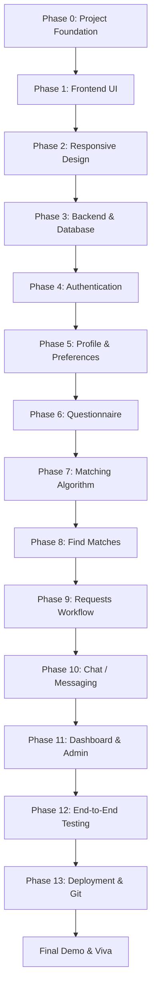

# NestMatch — Development Roadmap & Matching Algorithm Specification

## 1. 14-Phase Sequential Development Lifecycle

NestMatch strictly adheres to a modular, sequential milestone lifecycle. No subsequent phase is initiated until the preceding phase is verified, tested, and locked.

---

## 2. Phase Breakdown & Deliverables

| Phase | Milestone | Key Deliverables | Status |
|---|---|---|---|
| **Phase 0** | **Project Foundation** | Architecture lock, directory tree, dependencies, docs, Git init, zero feature bloat. | **Completed & Verified** |
| **Phase 1** | **Frontend UI** | Modern UI layouts, atomic components, navigation bars, cards, styling with Tailwind CSS. | **Completed & Verified** |
| **Phase 2** | **Responsive Design** | Mobile-first breakpoint audits (320px to 1920px), responsive drawer/navbars, touch targets. | **Completed & Verified** |
| **Phase 3** | **Backend + Database** | Express API scaffolding, MongoDB Atlas connection, Mongoose model declarations. | **Completed & Verified** |
| **Phase 4** | **Authentication** | Registration, login, password hashing via bcryptjs, JWT token generation & verification (startup validated). | **Completed & Verified** |
| **Phase 5** | **Profile + Preferences** | Student profile CRUD, dynamic profile completeness recalculation (`checkProfileCompleteness`). | **Completed & Verified** |
| **Phase 6** | **Questionnaire** | Multi-step interactive survey capturing all 15 domestic lifestyle dimensions. | **Completed & Verified** |
| **Phase 7** | **Matching Algorithm** | Weighted scoring calculation engine with partial profile evaluation & budget tier distance scoring. | **Completed & Verified** |
| **Phase 8** | **Find Matches** | Ranked match list view, compatibility badges, filter bars, detailed match inspection modal. | **Completed & Verified** |
| **Phase 9** | **Requests Workflow** | Peer roommate request initiation, concurrency protection (`activePairKey` partial unique index), atomic accept. | **Completed & Verified** |
| **Phase 10** | **Chat / Messaging** | Direct messaging between mutually confirmed roommate pairs, batched aggregation for unread counts. | **Completed & Verified** |
| **Phase 11** | **Dashboard + Admin** | Student overview dashboard, Admin user table, status toggling, report moderation, safe regex search. | **Completed & Verified** |
| **Phase 12** | **Testing & QA** | 26 unit tests + 22 automated end-to-end API tests (48 passing), client Vite build & Oxlint pass. | **Completed & Verified** |
| **Phase 13** | **Deployment & GitHub** | Vercel (client), Render (server), MongoDB Atlas configuration, safe seed script guard. | **Completed & Verified** |
| **Viva** | **Demo & Defense** | Academic demonstration, architecture walkthrough, algorithm explanation, code presentation. | **Ready for Evaluation** |

---

## 3. Matching Algorithm Specification

The core differentiator of NestMatch is an **explainable compatibility score** rather than an opaque black box.

### 3.1 Weight Distribution
Domestic harmony hinges more heavily on sleep rhythms and financial parity than secondary factors. Thus, each dimension is assigned a validated weight factor ($W_i$):

| Lifestyle Dimension | Weight ($W_i$) | Scoring Method |
|---|---|---|
| **Sleep Schedule** | **20%** | Categorical agreement (`1.0` if match, `0.5` if flexible, `0.1` if clash) + wake-up time proximity |
| **Budget Parity** | **20%** | Tier distance scoring: diff 0 = `1.0`, diff 1 = `0.65`, diff 2 = `0.25`, diff 3 = `0.0` |
| **Cleanliness Standard** | **15%** | Tier distance scoring: diff 0 = `1.0`, diff 1 = `0.60`, diff 2 = `0.15` |
| **Food & Dietary Habits** | **10%** | Dietary harmony matrix (veg vs. non-veg compatibility) |
| **Noise Tolerance** | **10%** | Sound level tolerance evaluation (diff 0 = `1.0`, diff 1 = `0.60`, diff 2 = `0.20`) |
| **Study Habits** | **10%** | Quiet room study vs. collaborative study environments |
| **Social Extroversion** | **10%** | Frequency of visitors, guest hosting, and room socialization |
| **Other Lifestyle Factors** | **5%** | Smoking tolerance policy adherence (conflict = `0.0`) |
| **Total Evaluated** | **100%** | Normalized strictly to range **0 – 100%** |

### 3.2 Incomplete Profile & Partial Evaluation Formula
If either student has not declared a specific preference dimension, NestMatch **does not silently invent default values** or artificially inflate compatibility. Instead, it evaluates only the overlapping declared factors and normalizes by their applicable weight:

$$\text{Compatibility Score} = \left( \frac{\sum_{i \in \text{Evaluated}} W_i \times \text{MatchFactor}(P_{A,i}, P_{B,i})}{\sum_{i \in \text{Evaluated}} W_i} \right) \times 100$$

- If factors are omitted, the match is flagged with `isPartial: true` and includes `evaluatedWeight` and `completenessRatio`.
- Missing categories are labeled with `status: 'Not Specified'` and `isEvaluated: false`.
- If no common factors exist, the algorithm returns `score: 0`.
- Self-matching returns `score: 0` with `compatibilityLevel: 'Self Match'`.

### 3.3 Explainability Output Contract
For every calculated candidate pair, the engine returns:
1. **Composite Score**: Integer between 0 and 100.
2. **Category Breakdown**: Granular list showing score, applicable weight, evaluation status, and harmony label for all 8 categories.
3. **Common Preferences**: Explicit list of aligned lifestyle habits (e.g., *"✓ Night Owl schedule"*, *"✓ Matching monthly budget tier"*).
4. **Differences**: Transparent list of divergent lifestyle habits (e.g., *"• Jordan is moderate while you are meticulous on room chores"*).
