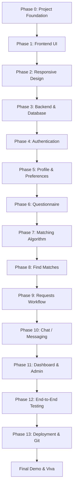

# NestMatch — Development Roadmap & Matching Algorithm Specification

## 1. 14-Phase Sequential Development Lifecycle

NestMatch strictly adheres to a modular, sequential milestone lifecycle. No subsequent phase is initiated until the preceding phase is verified, tested, and locked.

---

## 2. Phase Breakdown & Deliverables

| Phase | Milestone | Key Deliverables |
|---|---|---|
| **Phase 0** *(Current)* | **Project Foundation** | Architecture lock, directory tree, dependencies, docs, Git init, zero feature bloat. |
| **Phase 1** | **Frontend UI** | Modern UI layouts, atomic components, navigation bars, cards, styling with Tailwind CSS. |
| **Phase 2** | **Responsive Design** | Mobile-first breakpoint audits (320px to 1920px), responsive drawer/navbars, touch targets. |
| **Phase 3** | **Backend + Database** | Express API scaffolding, MongoDB Atlas connection, Mongoose model declarations. |
| **Phase 4** | **Authentication** | Registration, login, password hashing via bcryptjs, JWT token generation & verification. |
| **Phase 5** | **Profile + Preferences** | Student profile CRUD, college/city/course inputs, bio, avatar handling. |
| **Phase 6** | **Questionnaire** | Multi-step interactive survey capturing all 10+ domestic lifestyle dimensions. |
| **Phase 7** | **Matching Algorithm** | Weighted scoring calculation engine with granular explainability breakdown. |
| **Phase 8** | **Find Matches** | Ranked match list view, compatibility badges, filter bars, detailed match inspection modal. |
| **Phase 9** | **Requests Workflow** | Peer roommate request initiation, incoming request inbox, accept/reject state transitions. |
| **Phase 10** | **Chat / Messaging** | Direct messaging between mutually confirmed roommate pairs. |
| **Phase 11** | **Dashboard + Admin** | Student overview dashboard, Admin user table, status toggling, report moderation. |
| **Phase 12** | **Testing & QA** | Integration testing, API contract tests with Postman, input edge cases, error boundary checks. |
| **Phase 13** | **Deployment & GitHub** | Vercel (client), Render (server), MongoDB Atlas configuration, final GitHub tag. |
| **Viva** | **Demo & Defense** | Academic demonstration, architecture walkthrough, algorithm explanation, code presentation. |

---

## 3. Matching Algorithm Specification (Planned for Phase 7)

The core differentiator of NestMatch is an **explainable compatibility score** rather than an opaque black box.

### 3.1 Foundational Concept (Baseline Unweighted Model)
$$\text{Compatibility}_{\text{base}} = \left( \frac{\text{Number of Matching Preferences}}{\text{Total Preferences Evaluated}} \right) \times 100$$

### 3.2 Advanced Weighted Model
Domestic harmony hinges more heavily on sleep rhythms and financial parity than secondary factors. Thus, each dimension is assigned a validated weight factor ($W_i$):

| Lifestyle Dimension | Weight ($W_i$) | Rationale |
|---|---|---|
| **Sleep Schedule** | **20%** | Bedtime and wake-up synchronization prevents daily sleep disruption. |
| **Budget Parity** | **20%** | Rent and utility parity prevents financial conflict and disputes. |
| **Cleanliness Standard** | **15%** | Shared chore expectations and room tidiness comfort levels. |
| **Food & Dietary Habits** | **10%** | Kitchen sharing, vegetarian/non-vegetarian preferences. |
| **Noise Tolerance** | **10%** | Music, calls, and room volume expectations during daily living. |
| **Study Habits** | **10%** | Quiet room study vs. collaborative study environments. |
| **Social Extroversion** | **10%** | Frequency of visitors, guest hosting, and room socialization. |
| **Other Lifestyle Factors** | **5%** | Smoking tolerance, pet policies, and locality proximity. |
| **Total** | **100%** | Complete holistic compatibility index. |

### 3.3 Weighted Calculation Formula
$$\text{Compatibility Score} = \sum_{i=1}^{n} \left( W_i \times \text{MatchFactor}(P_{A,i}, P_{B,i}) \right)$$

Where:
- $\text{MatchFactor} = 1.0$ if preferences are identical.
- $\text{MatchFactor} = 0.5$ for adjacent/compatible preferences (e.g., *Ambivert* matches *Extrovert* partially).
- $\text{MatchFactor} = 0.0$ for incompatible direct conflicts (e.g., *Strictly Non-Smoker* vs *Heavy Smoker*).

### 3.4 Explainability Output Contract
For every calculated candidate pair, the engine returns:
1. **Composite Score**: Integer between 0 and 100.
2. **Common Preferences**: Explicit list of aligned lifestyle habits (e.g., *"Both prefer quiet study"*, *"Both sleep after midnight"*).
3. **Differences**: Transparent list of divergent lifestyle habits (e.g., *"Alex prefers strict quiet; Jordan prefers moderate noise"*).
